The Point of Service (POS) api is a comprehensive ResTech platform that transforms restaurant technology through versatile digital solutions. It was developed by Point of Service Solutions. The Point of Service (POS) API supports three primary application types, each serving distinct roles in the restaurant ecosystem. 

- **Food Ordering Applications:** Customer-facing platforms enabling menu browsing, order customization, and purchase completion.
- **Kitchen Display Systems (KDS)**: Digital systems for kitchen staff to efficiently manage and track order preparation.
- **Admin Applications**: Backend platforms for restaurant management and business operations control.

## API Architecture

The POS Platform serves as the central hub connecting all frontend applications through a unified API layer.



### Core Components

**API Gateway**
- Handles authentication and request routing (`POST /auth/token`)
- Rate limiting and request validation
- Cross-origin resource sharing (CORS) support

**Order Management Service**
- Complete order lifecycle management (`POST /orders`, `PUT /orders/{id}`)
- Real-time order status updates
- Queue prioritization and scheduling

**User Management Service**
- Role-based access control (`GET /users`, `POST /users`)
- Authentication and authorization
- Permission management across user types

**Menu Service**
- Dynamic menu management (`GET /dishes`, `POST /dishes`)
- Real-time ingredient availability
- Pricing and categorization

**Inventory Service**
- Ingredient stock tracking (`GET /ingredients`, `POST /ingredients`)
- Automated low-stock alerts
- Supply chain integration ready

## API Fundamentals

### Base URL
```
http://localhost:80/
```

### Authentication
The API uses OAuth 2.0 with JWT tokens for secure access control:

```bash
# Get access token
curl -X POST "http://localhost:80/auth/token" \
  -H "Content-Type: application/json" \
  -d '{
    "grant_type": "password",
    "user_name": "your_username",
    "password": "your_password"
  }'

# Use token in requests
curl -X GET "http://localhost:80/orders" \
  -H "Authorization: Bearer YOUR_ACCESS_TOKEN"
```

### User roles & permissions

| Role | Description | Key Permissions |
|------|-------------|-----------------|
| **Patron** | End customers | View menu, place orders, track order status |
| **Expeditor** | Order coordination staff | Manage order queue, update order status |
| **Chef** | Kitchen staff | View assigned orders, update preparation status |
| **Manager** | Restaurant administrators | Full access to all resources and analytics |

### Data Flow

The system ensures real-time synchronization across all applications:

1. **Customers** place orders via Food Ordering Apps (`POST /orders`)
2. **Orders** are instantly visible in Kitchen Display Systems (`GET /orders?status=Received`)
3. **Staff** updates order status (`PUT /orders/{id}`), reflecting changes across all apps
4. **Admins** monitor operations and adjust settings (`PUT /dishes/{id}`, `DELETE /users/{id}`)
5. **Real-time updates** propagated via RESTful APIs and WebSocket connections

## Key API Endpoints

### Order Management
```
POST   /orders                    # Create new orders
GET    /orders                    # List orders with filtering
GET    /orders/{id}               # Get specific order details
PUT    /orders/{id}               # Update order status/details
DELETE /orders/{id}               # Cancel orders
GET    /orders/{id}/dishes        # Get dishes for specific order
```

### Menu & Inventory
```
GET    /dishes                    # Browse available dishes
POST   /dishes                    # Create new menu items (admin)
GET    /dishes/{id}               # Get dish details and ingredients
GET    /dishes/{id}/ingredients   # Check ingredient availability
POST   /ingredients               # Add new ingredients (admin)
GET    /ingredients/{id}          # Check stock levels
```

### User & Authentication
```
POST   /users                     # Create user accounts
GET    /users                     # List users (admin)
POST   /auth/token               # Authenticate and get access token
POST   /auth/refresh-token       # Refresh expired tokens
```

## Request & Response Format

### Standard Request
```json
{
  "name": "Benjamin",
  "table_number": 18,
  "dish_ids": [
    "66e6a90a5eb1ced30f93c32a",
    "66e6a90a5eb1ced30f93c31e"
  ],
  "special_requests": "No peanuts",
  "scheduled_at": null
}
```

### Standard Response
```json
{
  "id": "66e2d159ea5ad311fdfc55a3",
  "created_at": "2024-09-12T11:32:41.440Z",
  "updated_at": "2024-09-12T11:32:41.440Z",
  "name": "Benjamin",
  "table_number": 18,
  "status": "Received",
  "priority": 3,
  "dish_ids": [
    "66e6a90a5eb1ced30f93c32a",
    "66e6a90a5eb1ced30f93c31e"
  ]
}
```

### Pagination
```json
{
  "results": [
    { /* order object */ }
  ],
  "total_results": 45,
  "limit": 10,
  "offset": 0
}
```

## Security Features

- **OAuth 2.0 Authentication**: Industry-standard security protocol
- **Role-Based Access Control (RBAC)**: Granular permission management
- **JWT Tokens**: Secure, stateless authentication
- **HTTPS Enforcement**: All API requests must use TLS encryption
- **Request Rate Limiting**: Prevents API abuse and ensures fair usage
- **Data Encryption**: Sensitive data encrypted at rest and in transit

## Getting Started

Ready to integrate the POS API? Choose your path:

### 🚀 **Quick Start**
- [Quick start guide](/getting-started/quick-start) - Get your first API call working
- [Authentication guide](/getting-started/authentication) - Secure your API access
- [Making your first request](/getting-started/making-first-request) - Step-by-step examples

### 📚 **Integration Guides**
- [Food ordering application guide](/guides/patron-flow) - Build customer applications
- [Kitchen display system guide](/guides/kitchen-display) - Develop kitchen interfaces  
- [Admin panel guide](/guides/admin-panel) - Create management dashboards

### 📖 **API Reference**
- [Complete API documentation](/api-reference) - Detailed endpoint documentation
- [Error handling Guide](/api-reference/error-handling) - Troubleshooting and error codes

